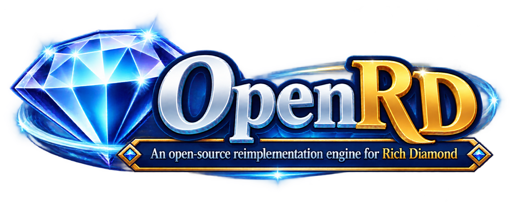
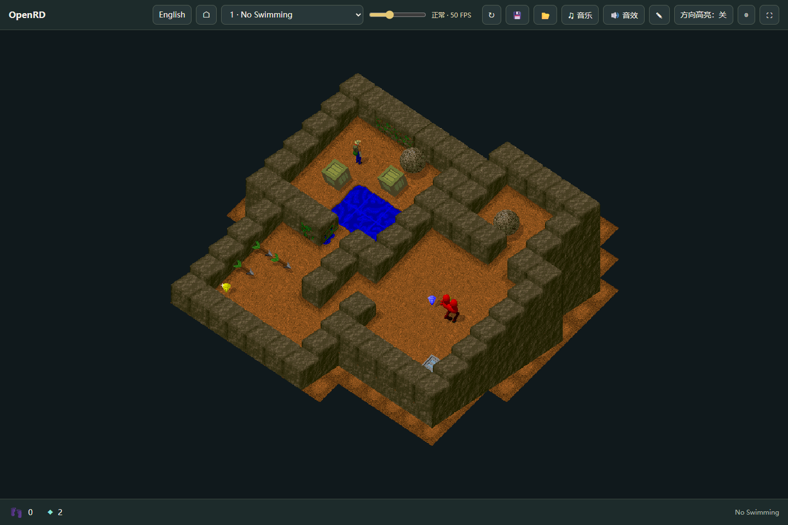
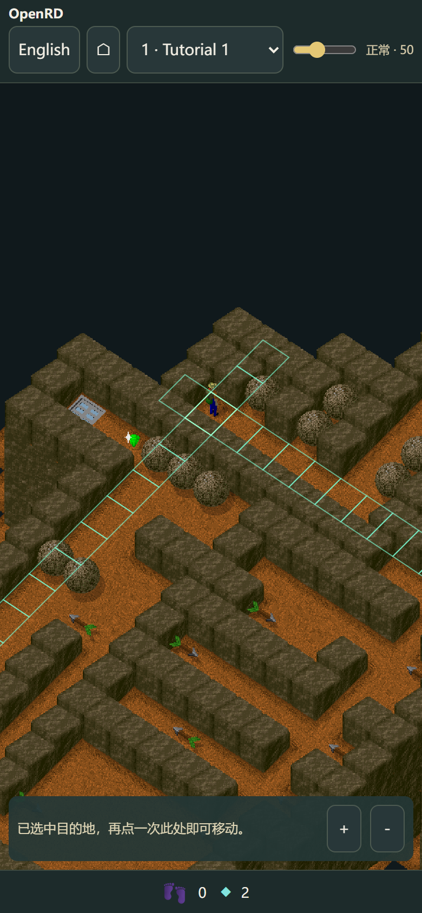
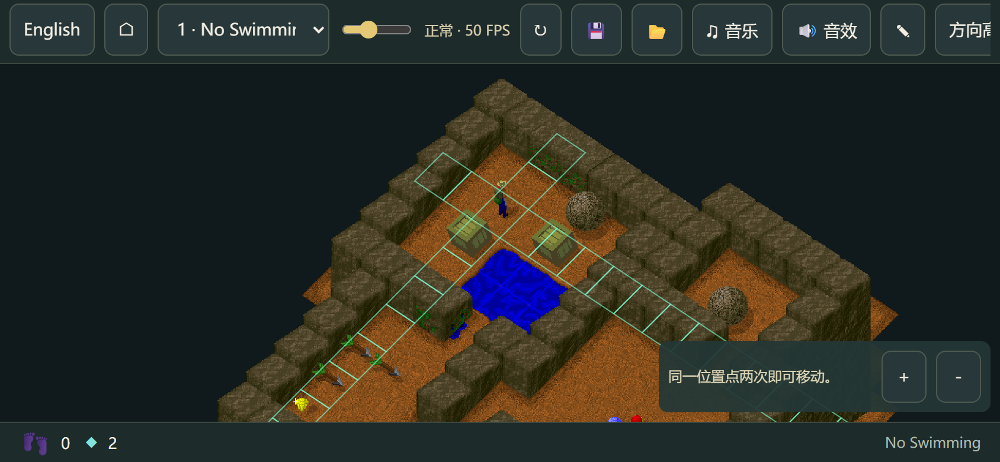

<p align="center">
  
</p>

# OpenRD

**Rich Diamond 开源重实现引擎 / An open-source reimplementation engine for Rich Diamond**

OpenRD 让你在浏览器中重温 Rich Diamond，支持 PC 与手机、中文与 English、本地存档和排行榜。请自备已支持的原版游戏数据；仓库不包含原作运行素材。

Play Rich Diamond in your browser, with desktop and mobile controls, Chinese and English, local saves and rankings. Bring your own supported game data; original runtime assets are not included.

## 写在前面 / A personal note

Rich Diamond 陪伴我度过了年少时的许多时光。那些钻石、迷宫和反复思索后终于找到出口的喜悦，至今仍留在我的记忆里。如今，创造它的公司已渐渐淡出人们的视野，但我相信，优秀的作品不会随着时间消失，而会在一代又一代玩家之间继续流传。我做 OpenRD，就是希望这份乐趣能够延续。欢迎你通过这个项目第一次认识 Rich Diamond，也欢迎老玩家回来，重温当年的快乐。

Rich Diamond was part of my younger years. I still remember its diamonds, its mazes, and the joy of finally finding a way out after puzzling over a level. The company that created it has since faded from view, but I believe great games live on through the people who play and remember them. I built OpenRD to help keep that joy alive. Whether you are discovering Rich Diamond for the first time or returning to a game you once loved, you are warmly welcome to play through this project.

## 实际游戏截图 / Actual game screenshots

实际游戏画面；手机截图采用浏览器设备模拟。

Actual gameplay; mobile screenshots use browser device emulation.

**PC · 正式第 1 关 / Full-game level 1 · 1440×960**



| 手机竖屏 · 演示第 1 关 / Mobile portrait · Demo level 1 | 手机横屏 · 正式第 1 关 / Mobile landscape · Full-game level 1 |
| --- | --- |
|  |  |

[查看全部截图 / View all screenshots](docs/SCREENSHOTS.md)

## 快速开始 / Quick start

1. 安装 Python 3.10+，下载本项目。 / Install Python 3.10+ and download this project.
2. 安装准备游戏数据所需的依赖。 / Install dependencies for preparing game data.

   ```powershell
   python -m pip install -r requirements-build.txt
   ```

3. 将已支持的 ISO 或游戏目录放入项目的 `game` 文件夹，然后启动。 / Place a supported ISO or game directory in the project's `game` folder, then launch.

   ```powershell
   python play.py
   ```

Windows 也可双击 `play.cmd`。浏览器会自动打开；按 Ctrl+C 停止。也可直接指定数据路径：

On Windows, you can also double-click `play.cmd`. Your browser opens automatically; press Ctrl+C to stop. To specify a data path:

```powershell
python play.py "D:\Games\Rich Diamond"
```

[完整使用指南：输入格式、试玩下载、解包工具、端口与局域网 / Full guide: inputs, demo downloads, extraction tools, ports and LAN](docs/USAGE.md)

## 操作 / Controls

- **PC：**单击目的地。 / Click a destination.
- **手机 / Mobile：**点选目的地，再点同一格行动。 / Select a destination, then tap it again to move.
- **方向高亮 / Direction highlights：**标出人物同行、同列，可在设置中切换。 / Mark the player's row and column; toggle in settings.
- **语言 / Language：**中文与 English 随时切换，自动记忆。 / Switch anytime; your preference is saved.

## 支持范围 / Compatibility

已核验的基准 ISO 支持 80 个正式关卡及 5 个演示关卡；匹配的游戏目录只加载所提供的内容。其他来源可导入资源，但原版试玩或授权范围尚未核实的关卡暂不开放。当前仍在完善兼容性，不保证所有发行版、画面与时序完全等同原版。

The verified reference ISO supports 80 full-game levels and 5 demos; matching directories load only the supplied content. Other sources can be imported as resources, but levels with unverified native demo or licensed scope remain blocked. Compatibility is still evolving; equivalence across all releases, visuals and timing is not guaranteed.

## 版权与许可 / Copyright and license

Rich Diamond 由 **Core Concepts, Incorporated** 开发，原作内容归相关权利人所有。感谢原作团队。OpenRD 是独立项目，无隶属、授权或背书关系；游戏数据由用户自行提供。

Rich Diamond was developed by **Core Concepts, Incorporated**; original content belongs to its rights holders. We thank the original team. OpenRD is an independent project with no affiliation, authorization or endorsement; users supply their own game data.

OpenRD 自编代码与原创文档采用 [MIT License](LICENSE)。原作素材、游戏截图与项目品牌图的许可范围见 [COPYRIGHT.md](COPYRIGHT.md)。

OpenRD's original code and documentation use the [MIT License](LICENSE). See [COPYRIGHT.md](COPYRIGHT.md) for original assets, gameplay screenshots and project artwork.

[项目视觉 / Project artwork](docs/BRANDING.md)
