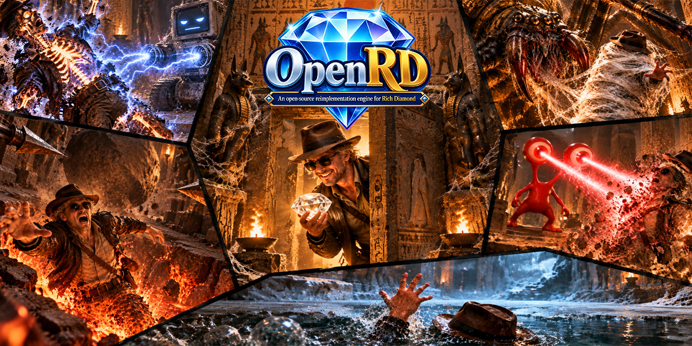
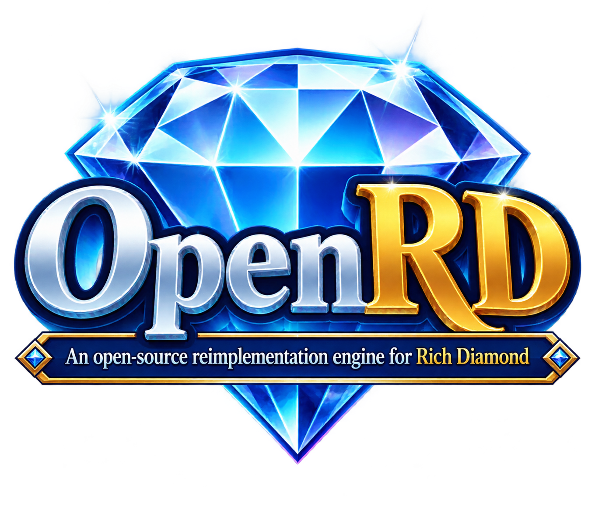
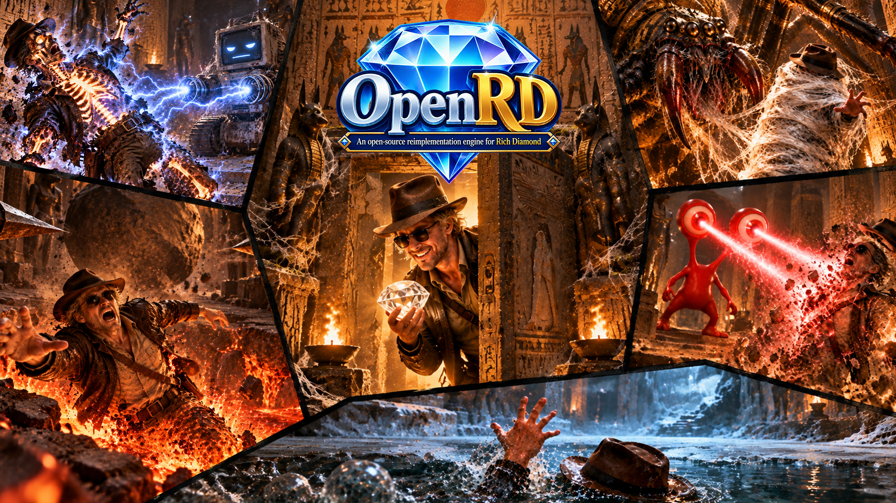

# OpenRD 品牌素材

[返回项目首页](../README.md)

本页收录用户提供的 OpenRD 项目标识和概念宣传图，不包含从原游戏提取的运行资源。宣传图不代表当前游戏截图或已完成的原版画面还原。

## 横幅 Logo

用于仓库 README 顶部；横向排版保留项目名和英文说明。

## 分享封面

用于 GitHub 仓库 Settings → Social preview。JPG 为 1280×640、868214 字节，适合仓库链接分享卡片。

## 完整 Logo

用于项目介绍页、文档封面和大尺寸展示；小尺寸时优先使用简版。

## 简版 Logo

用于较小的项目标识；头像使用时需保留边缘留白。

## 概念宣传图

用于项目宣传和重要发布公告。下图为概念宣传图，非游戏截图。

许可范围 / Licensing scope: [COPYRIGHT.md](../COPYRIGHT.md). 本页图片不采用 MIT / Images on this page are not MIT-licensed.
